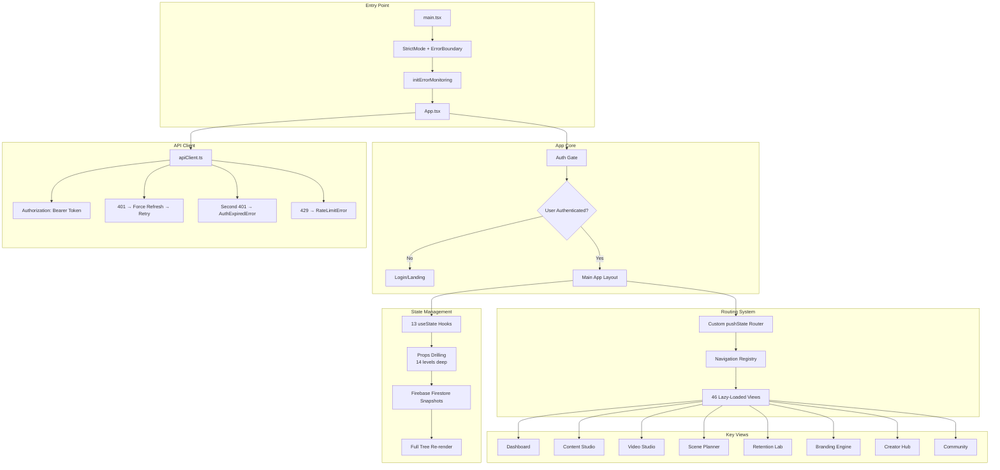
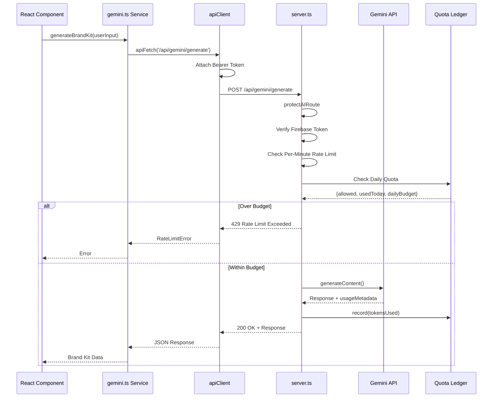
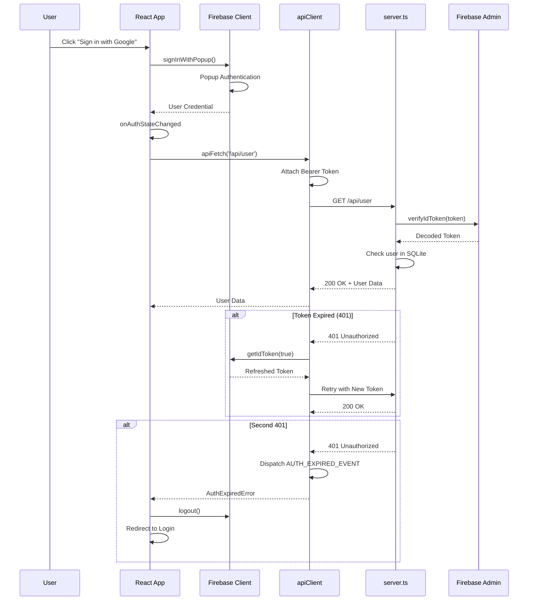
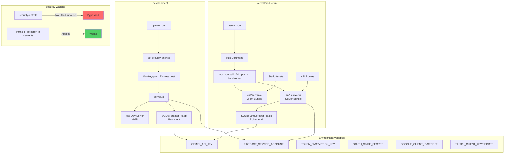
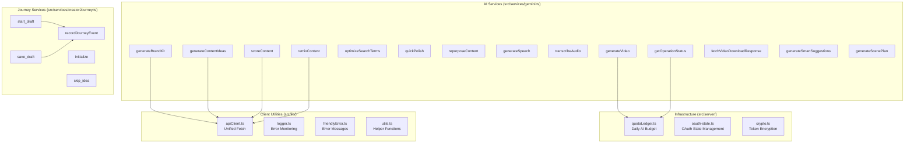
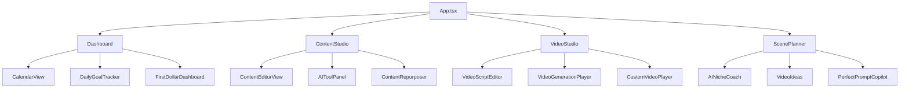
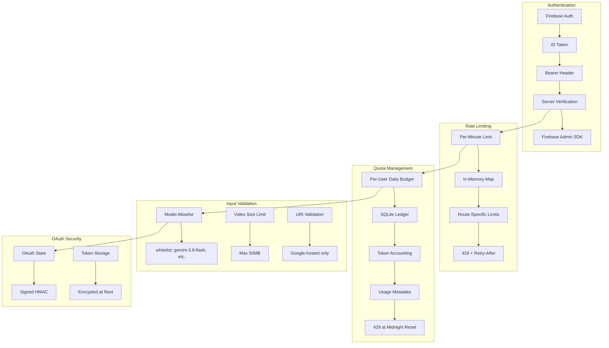

# CreatorOS Architecture Diagram

This document provides a comprehensive overview of the CreatorOS system architecture, including data flow, component relationships, and deployment topology.

## High-Level Architecture

```mermaid
graph TB
    subgraph "Client Layer (React + Vite)"
        A[main.tsx] --> B[App.tsx]
        B --> C[Custom Router]
        C --> D[46 Lazy-Loaded Views]
        D --> E[Components]
        D --> F[Services]
        E --> G[Firebase Client SDK]
        F --> H[apiClient]
    end

    subgraph "API Layer (Express + Node)"
        I[security-entry.ts<br/>Dev Entry] --> J[server.ts]
        K[api/_server.js<br/>Vercel Entry] --> J
        J --> L[Express Routes]
        L --> M[Authentication Middleware]
        L --> N[Rate Limiting]
        L --> O[Quota Ledger]
        L --> P[Gemini AI Service]
        L --> Q[OAuth Handlers]
    end

    subgraph "Data Layer"
        R[Firebase Firestore<br/>Client Store]
        S[SQLite (better-sqlite3)<br/>Server Store<br/>Ephemeral on Vercel]
        T[PostgreSQL + Drizzle<br/>Unused Scaffolding]
    end

    subgraph "External Services"
        U[Firebase Auth]
        V[Gemini API]
        W[Google OAuth]
        X[TikTok OAuth]
    end

    H --> L
    M --> U
    P --> V
    Q --> W
    Q --> X
    J --> S
    G --> R
    G --> U
```

## Frontend Architecture



## Backend Architecture

```mermaid
graph TB
    subgraph "Entry Points"
        A[security-entry.ts<br/>Development] --> B[Monkey-patch Express.post]
        B --> C[server.ts]
        D[api/_server.js<br/>Vercel] --> C
    end

    subgraph "server.ts Core"
        C --> E[Express App]
        E --> F[CORS Middleware]
        F --> G[Body Parser]
        G --> H[Cookie Parser]
    end

    subgraph "Security Layers"
        H --> I[authenticateUser<br/>Firebase Token Verification]
        I --> J[protectAIRoute<br/>AI-specific Protection]
        J --> K[Per-Minute Rate Limiting<br/>In-Memory Map]
        K --> L[Quota Ledger<br/>Daily Token Budget]
        L --> M[Model Allowlist]
        M --> N[Payload Guards<br/>Video Size, URI Validation]
    end

    subgraph "API Routes"
        N --> O[/api/user]
        N --> P[/api/brand]
        N --> Q[/api/content]
        N --> R[/api/analytics]
        N --> S[/api/habits]
        N --> T[/api/gemini/*]
        N --> U[/api/auth/*]
    end

    subgraph "AI Services"
        T --> V[generate]
        T --> W[analyze-video]
        T --> X[generate-image]
        T --> Y[generate-video]
        T --> Z[video-status]
        T --> AA[video-download]
    end

    subgraph "OAuth Handlers"
        U --> AB[Google OAuth]
        U --> AC[TikTok OAuth]
        AB --> AD[oauth-state.ts<br/>Signed State]
        AC --> AD
        AB --> AE[crypto.ts<br/>Token Encryption]
        AC --> AE
    end
```

## Data Layer Architecture

```mermaid
graph TB
    subgraph "Client Side (Firebase)"
        A[Firebase Client SDK] --> B[Firestore]
        B --> C[Users Collection]
        B --> D[Brands Collection]
        B --> E[Content Collection]
        B --> F[Analytics Collection]
        B --> G[Preferences Collection]
        B --> H[Creator Journey State]
    end

    subgraph "Server Side (SQLite)"
        I[better-sqlite3] --> J[users Table]
        I --> K[brands Table]
        I --> L[content Table]
        I --> M[analytics Table]
        I --> N[streaks Table]
        I --> O[challenges Table]
        I --> P[user_accounts Table<br/>OAuth Tokens]
        I --> Q[ai_usage_ledger Table<br/>Quota Tracking]
    end

    subgraph "Unused Scaffolding"
        R[PostgreSQL] --> S[Drizzle ORM]
        S --> T[schema.ts]
    end

    subgraph "Deployment Issue"
        U[Vercel Serverless] --> V[/tmp/creator_os.db]
        V --> W[Ephemeral Storage<br/>Data Loss Between Invocations]
    end

    I --> U
    style W fill:#ff6b6b
```

## AI Integration Flow



## Authentication Flow



## Deployment Topology



## Key Services Diagram



## Component Hierarchy (Sample)



## Security Architecture



## Known Issues & Technical Debt

Based on the APP_EVALUATION.md:

1. **Critical: Unauthenticated Gemini Abuse in Production**
   - Vercel deploys server.ts directly without security-entry.ts wrapper
   - Gemini routes may lack intrinsic protection in some paths
   - Fix: Move all auth + rate limiting into server.ts route handlers

2. **High: Server Data Loss on Vercel**
   - SQLite at /tmp/creator_os.db is ephemeral
   - Server writes vanish between invocations
   - Split-brain: Client uses Firestore, Server uses SQLite
   - Fix: Converge on Firestore for all persistence

3. **High: OAuth Account-Linking Forgery**
   - OAuth state = userId without session binding
   - Tokens stored plaintext in SQLite
   - Fix: Signed, session-bound state; encrypt tokens

4. **Medium: TypeScript Strict Mode Off**
   - 157 `any` types in codebase
   - AI payloads unvalidated
   - Fix: Enable strict mode incrementally; add zod schemas

5. **Medium: Navigation Ephemeral**
   - Tabs aren't URLs
   - No deep links
   - Back button doesn't restore state
   - Fix: Implement proper router with URL-based routing

## Tech Stack Summary

| Layer | Technology |
|-------|-----------|
| Frontend | React 19, Vite, TypeScript, Tailwind CSS, Motion (framer-motion) |
| Backend | Node.js, Express, TypeScript |
| Auth | Firebase Authentication (Client + Admin SDK) |
| Database | Firebase Firestore (Client), SQLite (Server - ephemeral) |
| AI | Google GenAI SDK (Gemini 3.8-flash, 3.1-flash-lite) |
| OAuth | Google OAuth2, TikTok OAuth |
| Deployment | Vercel (serverless functions) |
| Icons | Phosphor Icons, Lucide React |
| Charts | Recharts |

## File Structure

```
CreatorOS_Repo/
├── src/
│   ├── main.tsx                 # Entry point
│   ├── App.tsx                  # Root component + router
│   ├── firebase.ts              # Firebase client config
│   ├── db.ts                    # SQLite server database
│   ├── components/              # 46 React components
│   │   ├── Dashboard.tsx
│   │   ├── ContentStudio.tsx
│   │   ├── VideoStudio.tsx
│   │   ├── ScenePlanner.tsx
│   │   └── ...
│   ├── services/                # Business logic
│   │   ├── gemini.ts           # AI functions
│   │   ├── creatorJourney.ts   # Onboarding tracking
│   │   └── dailyGoals.ts
│   ├── lib/                     # Utilities
│   │   ├── apiClient.ts        # Unified fetch
│   │   ├── logger.ts           # Error monitoring
│   │   └── utils.ts
│   ├── server/                  # Server-side modules
│   │   ├── quotaLedger.ts      # AI quota tracking
│   │   ├── oauth-state.ts      # OAuth state management
│   │   └── crypto.ts           # Token encryption
│   └── hooks/                   # React hooks
│       └── useVideoGeneration.ts
├── server.ts                    # Express server
├── security-entry.ts            # Dev security wrapper
├── api/_server.js              # Vercel server bundle
├── vercel.json                 # Vercel config
├── firebase-applet-config.json # Firebase config
└── package.json                # Dependencies
```

## Data Flow Summary

1. **User Action** → React Component
2. **Component** → Service Function (gemini.ts, etc.)
3. **Service** → apiClient (attaches Bearer token)
4. **apiClient** → Express Route (/api/*)
5. **Express** → Firebase Admin (verify token)
6. **Express** → Quota Ledger (check budget)
7. **Express** → Gemini API (AI generation)
8. **Gemini** → Express (response + usage)
9. **Express** → Quota Ledger (record usage)
10. **Express** → apiClient (response)
11. **apiClient** → Service (parsed data)
12. **Service** → Component (state update)
13. **Component** → Firebase Firestore (persist)
